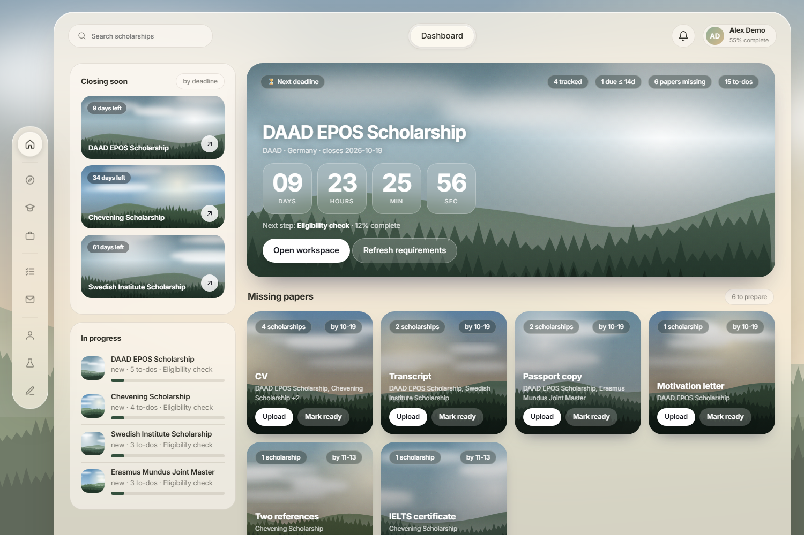
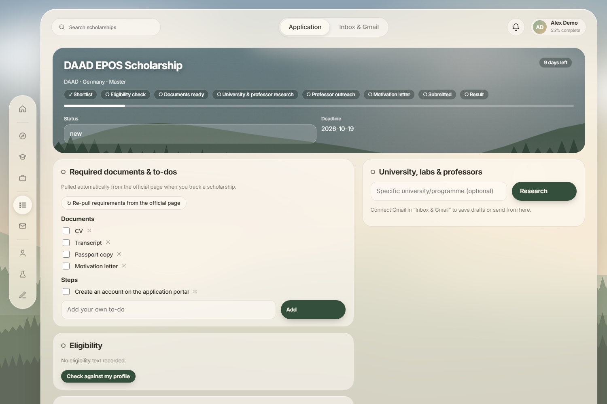
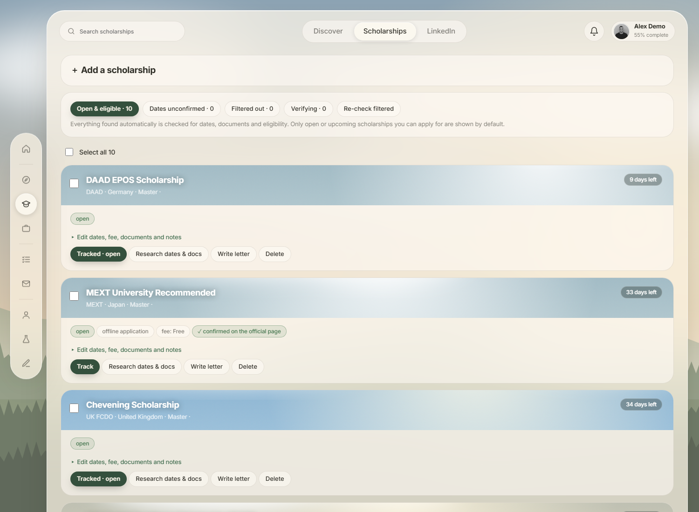
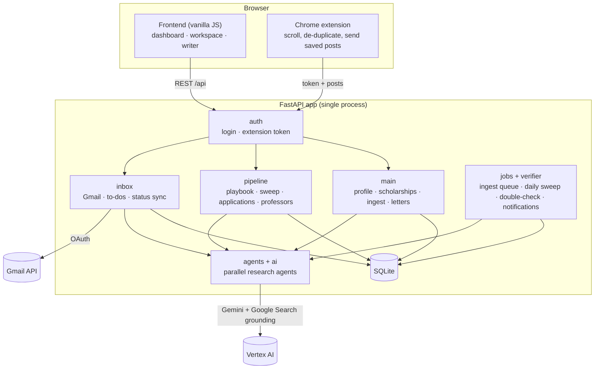

<div align="center">

# 🧭 ScholarPilot

**Your scholarship co-pilot. It finds open scholarships you are actually eligible for, double-checks their dates and documents, tracks every requirement to the deadline, researches professors and helps you write letters that sound like you.**


[](https://github.com/mohab-islam/scholarpilot/actions)




</div>

---

## Why

Applying for scholarships means juggling dozens of tabs: saved LinkedIn posts, aggregator blogs, official pages with different deadlines and document lists, professors to email, and one motivation letter you rewrite ten times. ScholarPilot puts all of it in one calm workspace and lets AI agents do the tedious reading, then verifies what they found before it reaches you.

## ✨ Features

| | |
|---|---|
| 🔎 **Find** | Parallel search agents sweep the web (Gemini + Google Search grounding) every day for scholarships matching your **country, degree and field**. |
| ✅ **Always verified** | Everything found automatically is checked twice (web research, then the official page itself). Only scholarships that are **open or upcoming and that you can apply for** are shown; the rest are filtered out with a reason. Cards show how each date was confirmed. |
| 💼 **LinkedIn → scholarships** | A Chrome extension scrolls your newest saved posts (50 by default), removes duplicates, skips non-scholarship posts and queues the rest for analysis on the server. Links inside posts are followed; aggregator pages lead to each scholarship's own page. LinkedIn finds are kept only if they are open now. |
| 🧹 **No duplicates** | The same programme from different sources, titles, accents, acronyms or URLs is merged into one record. Obvious matches merge by rule; uncertain ones are compared by the model once and remembered. Umbrella schemes and specific programmes, or the same scheme at different universities, stay separate. |
| 🔍 **Data audit** | `GET /api/audit` checks the whole collection (dates, duplicates, hidden tracked items, orphans); `POST /api/audit/fix` repairs what is safe. Link shorteners are resolved, partial dates like "2027-01" are normalised, application type and fee are cleaned. |
| 📋 **Requirements → to-do list** | Tracking a scholarship reads its official page into a checklist of documents and steps, including application type (online/offline) and fee. Documents you already uploaded count as covered. |
| 🗂️ **Missing papers, grouped** | One list across all applications: "CV", "Resume" and "Curriculum Vitae" become one item that shows how many applications need it. |
| ⚡ **Bulk actions** | Select many scholarships and track or dismiss them in one click. |
| ⏳ **Dashboard** | Live countdown to the nearest deadline, a timeline per application, pipeline funnel, discovery sparkline, deadline timeline and document-readiness ring. |
| 🔔 **Notifications** | In-app bell with unread count, plus an optional email summary ("12 new scholarships added") sent to your own Gmail when new verified ones arrive. |
| 🎓 **University and professors** | A research agent finds the programme, labs and matching professors with public pages and emails (only from official pages, never guessed) and drafts a specific cold email. |
| ✍️ **Letter lab** | Research agents gather what makes a strong letter; templates; an interview that draws out your real stories; **version history with diffs**; "sound like me" rewrite from your own writing; authenticity check for generic sentences. |
| ✉️ **Gmail** | Drafts, and sends only after explicit confirmation. A background watcher reads mail about the scholarships you track and **updates statuses automatically**; document requests become to-dos. |
| 🔐 **Private by design** | Single user, your data in your own SQLite file and your own Google Cloud project. Hosted mode adds login, HTTPS and strict host/origin checks. |

<table>
  <tr>
    <td><br><sub>Application workspace</sub></td>
    <td><br><sub>Verified scholarships with bulk actions</sub></td>
  </tr>
</table>

## 🚀 Run it locally

You need Python 3.11+, git, and (for the AI features) a Google account.

```bash
git clone https://github.com/mohab-islam/scholarpilot.git
cd scholarpilot
cp .env.example .env            # Windows: copy .env.example .env
./start.sh                      # Windows: start.bat   → http://127.0.0.1:8000
```

The app starts without any credentials, so you can look around. On first launch it asks for your **country, degree and field**; every search is filtered by it.

**No Google account yet?** Try the demo with sample data:

```bash
cd backend && python demo.py      # http://127.0.0.1:8777
```

### Provide the AI credentials (Gemini on Vertex AI)

The AI features (search, verification, research, letters) call Gemini through **Vertex AI** in *your* Google Cloud project. There is no API key to paste; the app uses your Google login.

1. Create a Google Cloud project and **enable billing** (new accounts get free credits): <https://console.cloud.google.com>
2. Install the [gcloud CLI](https://cloud.google.com/sdk/docs/install) and run:
   ```bash
   gcloud auth login
   gcloud config set project YOUR_PROJECT_ID
   gcloud services enable aiplatform.googleapis.com
   gcloud auth application-default login      # lets the app act as you, locally
   ```
3. Put the project id in `.env`:
   ```ini
   GOOGLE_CLOUD_PROJECT=YOUR_PROJECT_ID
   GOOGLE_CLOUD_LOCATION=us-central1
   GEMINI_MODEL=gemini-2.5-flash
   ```
4. Restart. Without `GOOGLE_CLOUD_PROJECT` the AI actions answer with a clear "Set GOOGLE_CLOUD_PROJECT" message instead of failing.

### Connect Gmail (optional)

1. `gcloud services enable gmail.googleapis.com`
2. Console → *Google Auth Platform*: configure the consent screen (**External**, add your own address as a **test user**) and add the scopes `gmail.readonly` and `gmail.compose`.
3. *Clients* → create an OAuth client of type **Desktop app** and download the JSON.
4. In the app open **Inbox & Gmail**, upload the JSON, press **Connect Gmail** and approve in the browser tab that opens.

While the consent screen is in *testing* mode Google expires the token after 7 days (publish the app, or reconnect weekly). To check mail and run the daily sweep while the app is open, set `WATCH_INTERVAL_MIN=20` in `.env`.

### Chrome extension (LinkedIn)

1. `chrome://extensions` → **Developer mode** → **Load unpacked** → select the `extension/` folder.
2. Open LinkedIn → *Saved posts*. A small ScholarPilot box appears; press **Scroll & send saved posts**.
3. Optional `extension/config.local.js` sets a default server and token for your machine (git-ignored):
   ```js
   self.SP_CONFIG = { srv: "https://your-server.example", tok: "YOUR_EXTENSION_TOKEN" };
   ```
   Or enter them in the popup under *Server settings*.

## ☁️ Run it always-on (hosted)

One small Google Cloud VM runs the app, an HTTPS reverse proxy, the Gmail watcher, the daily sweep and the verification worker (about €15/month plus AI usage). The VM uses its own service account for Vertex AI, so no keys are stored.

The condensed version (full commands in [`docs/DEPLOY.md`](docs/DEPLOY.md)):

1. Create the project, enable `compute`, `aiplatform`, `gmail`; create a service account with **Vertex AI User**.
2. Create a VM (Debian 12, `e2-small`) with that service account, a reserved IP and ports 80/443 open.
3. Point a domain at the IP (a free `<ip-with-dashes>.sslip.io` works with no setup).
4. Create the server `.env`:
   ```ini
   GOOGLE_CLOUD_PROJECT=YOUR_PROJECT_ID
   APP_PASSWORD=choose-a-strong-password        # turns the login page on
   SESSION_SECRET=<openssl rand -hex 32>
   EXTENSION_TOKEN=<openssl rand -base64 24>
   PUBLIC_URL=https://your.domain
   ALLOWED_HOSTS=your.domain
   DOMAIN=your.domain
   WATCH_INTERVAL_MIN=20
   ```
5. Copy the code to the VM and start the stack:
   ```bash
   docker compose -f docker-compose.prod.yml up -d --build
   ```
6. Connect Gmail with a **Web application** OAuth client whose redirect URI is `https://your.domain/api/gmail/callback`.

## ⚙️ Configuration

All settings are environment variables (see [`.env.example`](.env.example)). Nothing sensitive is stored in the repository.

| Variable | Purpose |
|---|---|
| `GOOGLE_CLOUD_PROJECT`, `GOOGLE_CLOUD_LOCATION`, `GEMINI_MODEL` | Vertex AI / Gemini |
| `APP_PASSWORD` | Turns on the login page (hosted mode); empty = open, for local use only |
| `SESSION_SECRET` | Signs the login cookie |
| `EXTENSION_TOKEN` | Lets the Chrome extension post LinkedIn data (two endpoints only) |
| `PUBLIC_URL`, `ALLOWED_HOSTS`, `DOMAIN` | Public address, accepted Host headers, reverse-proxy site name |
| `WATCH_INTERVAL_MIN` | Minutes between background Gmail checks (`0` = off) |
| `DAILY_SWEEP_HOUR_UTC` | Hour (UTC) of the daily internet sweep; also changeable in the app |
| `SP_DATA_DIR` | Where the database, Gmail token and avatar live |

Runtime settings (daily sweep on/off, hour, email summary) are on the **Inbox & Gmail** page.

## 🧱 How it works

FastAPI + SQLite, a framework-free JavaScript frontend with generated SVG artwork and an MV3 Chrome extension. AI agents are focused Gemini prompts, many grounded with Google Search and run in parallel. Background workers handle the LinkedIn queue, verification and the daily sweep. See [`docs/ARCHITECTURE.md`](docs/ARCHITECTURE.md).



```
backend/      FastAPI app (main · pipeline · inbox · jobs · verifier · agents · ai · auth · db) and demo.py
frontend/     index.html · dash.js · extra.js · theme.css · favicon.svg
extension/    Chrome extension (scroll, de-duplicate, send)
tests/        pytest suite
docs/         architecture, deployment guide, screenshots
```

## 🧪 Tests

```bash
pip install -r requirements-dev.txt
pytest
```

CI runs the tests, syntax-checks the JavaScript and builds the Docker image on every push.

## ⚠️ Good to know

- AI-extracted dates, requirements and eligibility can be wrong. Cards say how a date was confirmed; **always confirm on the official page before you apply.**
- No tool can guarantee a text is "100% human" or passes every AI detector. The writing tools use your real details and voice and point at generic sentences.
- Cold emails are drafted for you to review; nothing is sent without your explicit confirmation. The email summary goes only to your own address.
- Reading LinkedIn is limited to your own saved items in your own browser session and depends on LinkedIn's page markup.
- This is a personal project, not affiliated with any scholarship provider, LinkedIn or Google. Security notes are in [`SECURITY.md`](SECURITY.md).

## 📄 License

[MIT](LICENSE) © Mohab Islam
