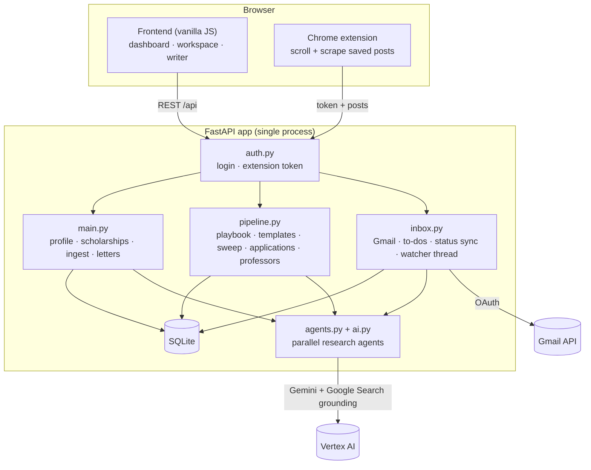

# Architecture

ScholarPilot is a small, dependency-light monolith: a FastAPI backend with SQLite, a framework-free JavaScript frontend, and a Chrome extension.

## Modules

| File | Responsibility |
|---|---|
| `backend/main.py` | App wiring, profile, scholarship CRUD and filtering, LinkedIn ingest (dedupe, keyword prefilter), letters with version history, humanize/authenticity tools |
| `backend/pipeline.py` | Letter-formula research (playbook), templates, parallel discovery sweep, pinned applications and their step timeline, university/professor research, cold-email drafts |
| `backend/inbox.py` | Gmail OAuth (desktop and web flows), drafts/send, mail sync that classifies emails and updates statuses, per-scholarship to-do lists pulled from official pages, dashboard aggregation, background watcher |
| `backend/jobs.py` | Background workers: LinkedIn ingest queue (server-side, survives browser close), daily internet sweep scheduler, notifications and the email summary |
| `backend/verifier.py` | Verification worker: web research, then a second read of the official page; reconciles dates, applies the open/eligible rules, notifies |
| `backend/agents.py` | Google-grounded search helper, parallel runner, prompts for research agents |
| `backend/ai.py` | Gemini client (Vertex AI), JSON extraction prompts, authenticity heuristics |
| `backend/auth.py` | Optional single-user login, signed session cookie, extension token |
| `backend/db.py` | Schema, lightweight migrations, JSON column helpers |
| `frontend/` | `index.html` (shell + scholarships/profile/writer views), `extra.js` (letter lab, discover, onboarding), `dash.js` (navigation, dashboard, workspace, inbox, generated artwork), `theme.css` |
| `extension/` | MV3 extension: `background.js` scrolls and scrapes, `popup.js` is the control panel |

## Data model (SQLite)

`profile` · `documents` · `scholarships` (incl. `pinned`, `steps_done`, `fit`, `research`) · `todos` · `professors` · `letters` + `letter_versions` · `playbook` · `templates` · `mail_events` · `seen_posts`

Schema changes are applied by `db.init()` (`CREATE IF NOT EXISTS` + additive column migrations), so upgrades never need a manual step.

## Key flows

**Finding scholarships.** Sweep, targeted search and LinkedIn all converge on `save_scholarship()`, which (1) merges duplicates by URL, exact name and a normalised name, and (2) for automatic sources drops anything closed, at the wrong degree level, or rated "not eligible" for your profile.

**LinkedIn ingest.** The extension scrolls the saved-posts page, removes duplicates, and posts small batches. The server skips posts it has seen (`seen_posts`), skips non-scholarship posts with a keyword prefilter (no AI call), extracts scholarships from the rest, and follows external links; aggregator pages are followed one level to each scholarship's own page.

**Tracking an application.** Pinning a scholarship triggers a background job that reads its official page (or searches the web) and builds a to-do list of documents and steps. Documents you already uploaded count as covered. The dashboard aggregates what is still missing across all tracked scholarships.

**Email-driven status.** The watcher (or *Sync now*) lists recent Gmail messages, keeps only those that mention tracked scholarships or professors, and asks the model to classify them (acceptance, rejection, interview, documents requested, professor reply, …). Statuses only move forward.

**Writing.** The motivation-letter prompt combines your profile and documents, the researched playbook, an optional template, the university research, and your answers to generated interview questions. Every change is a new version, with word-level diffs and restore.

## Verification and filtering

Everything found automatically starts as `pending`. The verifier researches it (Google-grounded), reads the official page independently and reconciles the two: if the dates agree it is `confirmed`; if they differ the official page wins. It then decides:

- `qualified`: open or upcoming, matches your degree level, not rated "not eligible". LinkedIn finds must be open now.
- `review`: dates could not be found. `rejected`: closed, wrong level or not eligible, with a reason.

Rejected records are kept (hidden) so the same scholarship is not re-added by the next sweep. Duplicates from different sources are merged by URL, normalised name and token similarity.

## Design choices

- **SQLite + one worker.** One user, one writer. A single process also guarantees the background watcher runs exactly once.
- **No frontend build step.** Plain ES modules-free scripts keep the project hackable; the generated "poster" artwork is deterministic SVG so there are no image assets.
- **Honest AI.** Extraction never invents dates (empty is allowed), professor emails are only taken from public official pages, and the "authenticity check" points at generic sentences instead of promising to beat detectors.
